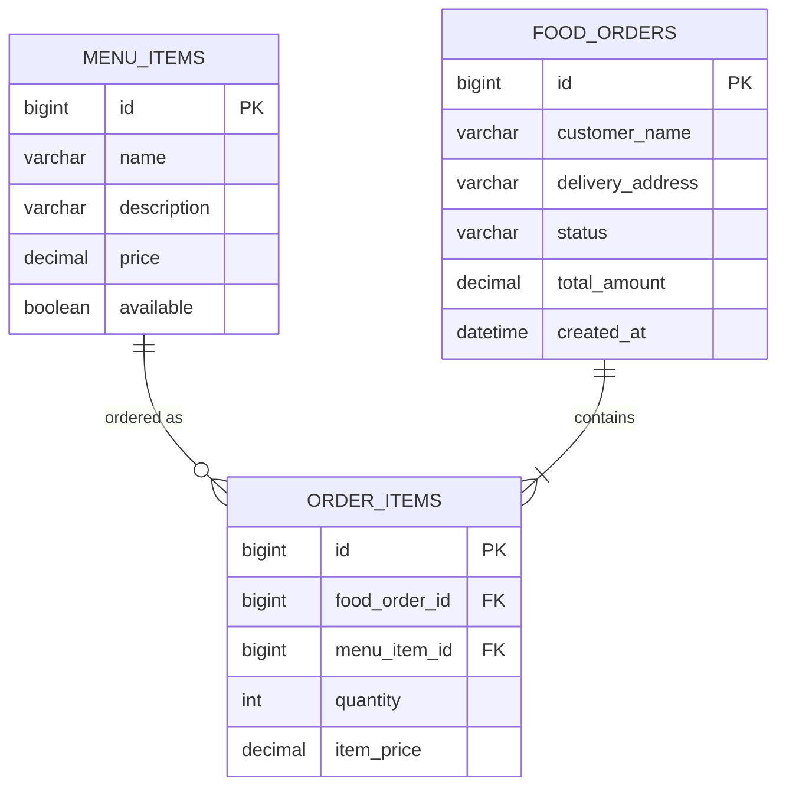

[README.md](https://github.com/user-attachments/files/33344082/README.md)
<div align="center">

# 🍔 FoodOrderApp

### Food Order & Delivery System

A full-stack food ordering application with a layered Spring Boot REST backend, MySQL persistence, and a lightweight HTML/JavaScript frontend.


</div>

---

## 📑 Table of Contents

- [Overview](#-overview)
- [Features](#-features)
- [Architecture](#-architecture)
- [Tech Stack](#-tech-stack)
- [Project Structure](#-project-structure)
- [Database Design](#-database-design)
- [Getting Started](#-getting-started)
- [REST API Reference](#-rest-api-reference)
- [Error Handling](#-error-handling)
- [Design Decisions](#-design-decisions)
- [Testing](#-testing)
- [Roadmap](#-roadmap)
- [Screenshots](#-screenshots)
- [Author](#-author)
- [License](#-license)

---

## 🔎 Overview

**FoodOrderApp** lets customers browse a food menu, build a cart, and place delivery orders. An admin page lists every order and moves it through the delivery workflow: `PENDING → CONFIRMED → DELIVERED`.

The backend is a clean monolith following a **Controller → Service → Repository → Entity** layering, with DTOs at the API boundary. The frontend is static HTML, Bootstrap 5, and vanilla JavaScript served directly by Spring Boot, so there is no frontend build step.

Order totals are always calculated **on the server** from database prices. The client sends only menu item IDs and quantities, so a tampered request cannot change what an order costs.

## ✨ Features

| Area | Capability |
|---|---|
| **Menu** | Customers see only available items; admins can list the full menu |
| **Ordering** | Cart with live totals, name and address capture, order confirmation |
| **Pricing** | Server-side total calculation with a per-line price snapshot |
| **Admin tracking** | Order list, status filter, one-click status progression |
| **Workflow rules** | Forward-only status transitions (no skipping, no going back) |
| **Validation** | Jakarta Bean Validation with field-level errors surfaced in the UI |
| **Error handling** | Centralized `@RestControllerAdvice` with a consistent JSON error shape |
| **Data integrity** | Transactional order placement: the order and its items save atomically |
| **Sample data** | Menu is seeded automatically when the table is empty |
| **API docs** | Interactive Swagger UI generated by SpringDoc |

## 🏗️ Architecture

```text
┌──────────────────────┐        HTTP / JSON        ┌────────────────────────────────────┐
│  Static Frontend     │ ────────────────────────▶ │  Spring Boot Application           │
│  HTML + Bootstrap +  │                           │                                    │
│  Vanilla JS (fetch)  │ ◀──────────────────────── │  Controller  (REST, validation)    │
└──────────────────────┘                           │      │                             │
                                                   │  Service     (business rules,      │
                                                   │      │        @Transactional)      │
                                                   │  Repository  (Spring Data JPA)     │
                                                   └──────────────┬─────────────────────┘
                                                                  │ JDBC
                                                          ┌───────▼────────┐
                                                          │    MySQL 8     │
                                                          └────────────────┘
```

**Order placement flow**

1. The client sends `customerName`, `deliveryAddress`, and `items[{menuItemId, quantity}]`.
2. The controller validates the request body (`@Valid`).
3. The service loads each menu item, rejects missing or unavailable ones, and snapshots the current price.
4. The total is computed with `BigDecimal` and the order plus its items are saved in one transaction.
5. A response DTO is returned with `201 Created` and a `Location` header.

## 🛠️ Tech Stack

| Layer | Technology |
|---|---|
| Language | Java 21 |
| Framework | Spring Boot 4, Spring Web MVC |
| Persistence | Spring Data JPA, Hibernate ORM |
| Database | MySQL 8 |
| Validation | Jakarta Bean Validation |
| API docs | SpringDoc OpenAPI (Swagger UI) |
| Utilities | Lombok |
| Build | Maven |
| Frontend | HTML5, Bootstrap 5 (CDN), vanilla JavaScript |

## 📂 Project Structure

```text
FoodOrderApp/
├── src/
│   ├── main/
│   │   ├── java/com/DeliveryFoodOrderApp/
│   │   │   ├── config/          DataInitializer (seeds sample menu)
│   │   │   ├── controller/      MenuController, OrderController
│   │   │   ├── dto/             Request and response DTOs
│   │   │   ├── entity/          MenuItem, FoodOrder, OrderItem, OrderStatus
│   │   │   ├── exception/       GlobalExceptionHandler, ErrorResponse, custom exceptions
│   │   │   ├── repository/      Spring Data JPA repositories
│   │   │   ├── service/         Service interfaces and implementations
│   │   │   └── FoodOrderAppApplication.java
│   │   └── resources/
│   │       ├── application.properties
│   │       └── static/
│   │           ├── index.html   Landing page
│   │           ├── menu.html    Customer ordering page
│   │           ├── orders.html  Admin order tracking
│   │           └── js/app.js    Shared frontend helpers
│   └── test/
├── pom.xml
├── .gitignore
└── README.md
```

## 🗄️ Database Design



| Table | Purpose |
|---|---|
| `menu_items` | Catalogue of food items with price and availability |
| `food_orders` | Order header: customer, address, status, total, timestamp |
| `order_items` | Order lines, each storing the **price at order time** |

## 🚀 Getting Started

### Prerequisites

- Java JDK 21 or higher
- MySQL Server 8 or compatible
- Maven (or the Maven wrapper, if included)
- An IDE such as Eclipse or IntelliJ IDEA (install the Lombok plugin or agent for Eclipse)
- Git

### 1. Clone the repository

```bash
git clone https://github.com/YOUR_USERNAME/FoodOrderApp.git
cd FoodOrderApp
```

### 2. Create the database

```sql
CREATE DATABASE fooddelivery_db;
```

### 3. Configure the application

Edit `src/main/resources/application.properties` with your local MySQL credentials:

```properties
spring.application.name=FoodOrderApp
server.port=8080

# MySQL
spring.datasource.url=jdbc:mysql://localhost:3306/fooddelivery_db
spring.datasource.driver-class-name=com.mysql.cj.jdbc.Driver
spring.datasource.username=YOUR_MYSQL_USERNAME
spring.datasource.password=YOUR_MYSQL_PASSWORD

# JPA / Hibernate
spring.jpa.hibernate.ddl-auto=update
spring.jpa.show-sql=true
spring.jpa.properties.hibernate.format_sql=true
spring.jpa.open-in-view=false

# Static frontend
spring.web.resources.cache.period=0
```

> Replace the placeholders with your own local credentials. Do not publish real credentials in a public repository.

### 4. Run the application

```bash
mvn spring-boot:run
```

Or import the project as an existing Maven project in your IDE and run `FoodOrderAppApplication` as a Spring Boot application.

### 5. Open the application

| Page | URL |
|---|---|
| Home | http://localhost:8080 |
| Order food | http://localhost:8080/menu.html |
| Admin: orders | http://localhost:8080/orders.html |
| Swagger UI | http://localhost:8080/swagger-ui.html |
| OpenAPI JSON | http://localhost:8080/v3/api-docs |

## 🌐 REST API Reference

Base path: `/api`

| Method | Endpoint | Description | Success |
|---|---|---|---|
| `GET` | `/menu` | List available menu items | `200` |
| `GET` | `/menu/all` | List all menu items, including unavailable | `200` |
| `POST` | `/orders` | Place a new order | `201` |
| `GET` | `/orders` | List all orders, newest first | `200` |
| `GET` | `/orders/{id}` | Get one order | `200` |
| `PATCH` | `/orders/{id}/status?status=CONFIRMED` | Advance an order's status | `200` |

### Place an order

**Request**

```http
POST /api/orders
Content-Type: application/json
```

```json
{
  "customerName": "Sai",
  "deliveryAddress": "12 Main Street, Chengalpattu",
  "items": [
    { "menuItemId": 1, "quantity": 2 },
    { "menuItemId": 2, "quantity": 1 }
  ]
}
```

**Response `201 Created`**

```json
{
  "id": 1,
  "customerName": "Sai",
  "deliveryAddress": "12 Main Street, Chengalpattu",
  "status": "PENDING",
  "totalAmount": 627.00,
  "createdAt": "2026-10-12T17:36:50.352",
  "items": [
    { "menuItemId": 1, "menuItemName": "Margherita Pizza", "quantity": 2, "itemPrice": 249.00, "lineTotal": 498.00 },
    { "menuItemId": 2, "menuItemName": "Veg Burger", "quantity": 1, "itemPrice": 129.00, "lineTotal": 129.00 }
  ]
}
```

## 🚨 Error Handling

All errors share one JSON shape, handled centrally by `GlobalExceptionHandler`. Stack traces are never returned to the client.

```json
{
  "timestamp": "2026-10-12T17:36:50.352",
  "status": 404,
  "error": "Not Found",
  "message": "Menu item not found with id 101",
  "fieldErrors": null
}
```

| Scenario | Status |
|---|---|
| Validation failure (blank name or address, empty items, quantity below 1) | `400` with `fieldErrors` |
| Unknown menu item or order ID | `404` |
| Ordering an unavailable item | `400` |
| Invalid status transition (e.g. `PENDING → DELIVERED`) | `400` |
| Malformed JSON or invalid enum value | `400` |
| Unexpected server error | `500` with a generic message |

## 🧠 Design Decisions

- **`BigDecimal` for money** to avoid floating-point rounding errors.
- **Price snapshot on `order_items`** so later menu price changes never alter historical orders.
- **DTOs at the API boundary** prevent infinite JSON recursion from entity relationships and stop clients from setting `id`, `status`, or `totalAmount`.
- **`@Transactional` services** with `readOnly = true` for queries; order placement is atomic.
- **`spring.jpa.open-in-view=false`** plus `@EntityGraph` to avoid lazy-loading errors and N+1 queries.
- **`@Enumerated(EnumType.STRING)`** so reordering the enum cannot corrupt stored data.
- **Forward-only status workflow** enforces domain integrity in the service layer.
- **Constructor injection** via Lombok's `@RequiredArgsConstructor` for immutable, testable dependencies.
- **Output escaping in the frontend** (`escapeHtml`) to prevent XSS when rendering data.
- **Idempotent seeding**: `DataInitializer` inserts sample data only when `menu_items` is empty.

## 🧪 Testing

```bash
mvn test
```

Manual testing is supported through Swagger UI or any HTTP client such as Postman.

## 🛣️ Roadmap

- [ ] Authentication and role-based access (admin vs customer) with Spring Security
- [ ] Pagination and sorting for the orders list
- [ ] Database migrations with Flyway
- [ ] Merge duplicate menu items within a single order request
- [ ] Admin menu management (create, edit, enable or disable items)
- [ ] Unit tests (JUnit, Mockito) and integration tests (MockMvc)
- [ ] Payment gateway integration
- [ ] Docker and Docker Compose setup

## 📸 Screenshots

| Menu & Cart | Admin Orders |
|---|---|
| _Add screenshot_ | _Add screenshot_ |

Save images in a `screenshots/` folder and reference them, for example ``.

## 👨‍💻 Author

**YOUR NAME**

- GitHub: [@YOUR_USERNAME](https://github.com/YOUR_USERNAME)
- LinkedIn: [your-profile](https://www.linkedin.com/in/your-profile)

## 📄 License

No license has been specified yet. Add a `LICENSE` file (for example MIT) if you want others to reuse the project.
